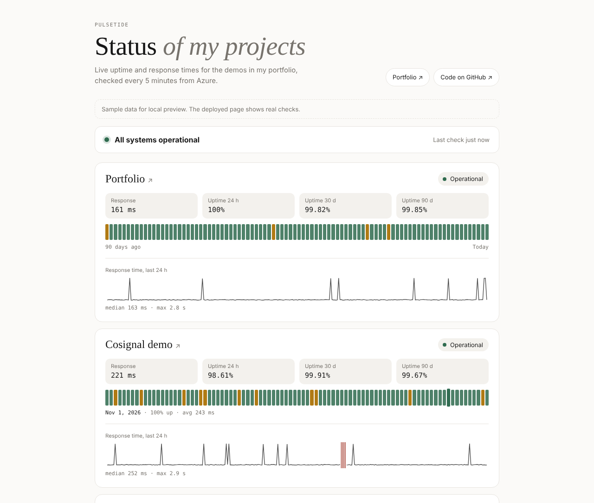
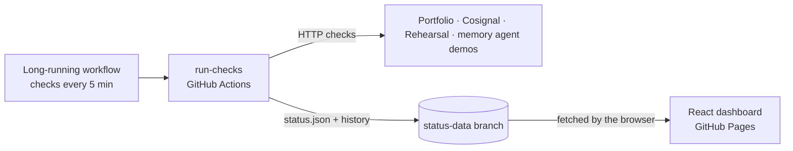
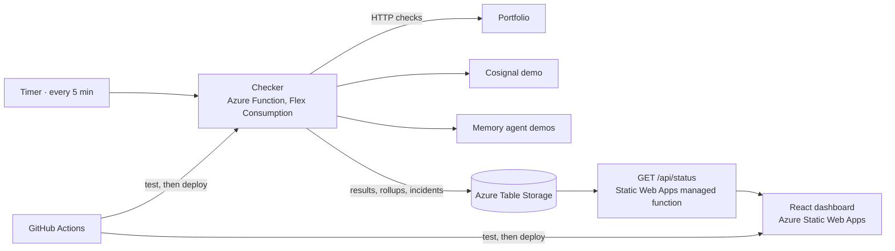

# Pulsetide

[](https://github.com/naveditachaudhary-pixel/pulsetide/actions/workflows/ci-cd.yml)
[](https://github.com/naveditachaudhary-pixel/pulsetide/actions/workflows/checks.yml)

**[Live status page →](https://naveditachaudhary-pixel.github.io/pulsetide/)**

A status page for my portfolio demos. About every 5 minutes, each site is checked and the results are recorded: whether it's up, how fast it answered, and why it failed if it did. A React dashboard shows the current status, 90 days of uptime, 24 hours of response times and recent incidents.

It runs entirely on GitHub today, using Actions for the checks and Pages for the dashboard. The same code also deploys to Azure Functions, Table Storage and Static Web Apps, and both setups share the check logic and its tests.



<sub>Screenshot from the local preview, which uses sample data and labels it as such.</sub>

## What it does

- **Checks about every 5 minutes**, and retries once before calling anything down, so a single dropped request isn't an outage.
- **Catches "successful" failures.** A site can return HTTP 200 and still be broken, for example a hosting error page. Each site can list text the page must contain, and if it's missing, the check fails.
- **Three states, in plain words:** *Operational*, *Slow* (over 2.5 s by default) and *Down*, with the reason, such as "HTTP 503", "Domain not found" or "No response within 10 s".
- **Incidents** open when a site goes down and close when it recovers, with start time, cause and duration.
- **90-day uptime bars and a 24-hour response chart** per site, refreshed every minute in the browser.
- **Honest about its limits.** Streamlit Cloud puts idle apps to sleep, and an HTTP request can't tell a sleeping app from an awake one. The dashboard says so instead of reporting a guess.

## Architecture

### How it runs today: GitHub only



- **Checks:** the [Checks workflow](.github/workflows/checks.yml) runs the same check code as the Azure Function. It keeps its history as a few JSON files on a `status-data` branch.
- **Data branch:** each run replaces that branch's single commit, so the repo doesn't grow by thousands of commits.
- **Dashboard:** built once on GitHub Pages. It reads `status.json` straight from the data branch, so new results show up without redeploying.
- **Size limits:** raw checks are kept for 25 hours, and daily rollups for about a year. The branch stays well under 1 MB.
- **Working around GitHub's scheduler:** GitHub starts scheduled jobs on a best-effort basis and often skips 5-minute schedules entirely. So each workflow run loops for about 5.5 hours, checking every 5 minutes and saving after each round, and an hourly schedule queues the next run behind it. The hourly trigger only has to fire once per window to keep the checks continuous. GitHub also pauses scheduled workflows in a public repo after 60 days without activity; if that happens, re-enable it from the Actions tab.

### Azure version



| Piece | Where it runs | What it does |
|---|---|---|
| `checker/` | Azure Functions (Flex Consumption), timer trigger | Checks every site, records results, opens and closes incidents, trims raw checks older than 30 days |
| `api/` | Azure Static Web Apps managed function | `GET /api/status`: everything the dashboard needs in one response, cached for 60 s |
| `web/` | Azure Static Web Apps (Free) | React + TypeScript dashboard built with Vite |
| `packages/core/` | Shared by all three | Check logic, storage, incident tracking and uptime maths, with no Azure-specific code except the storage adapter |
| `sites.json` | Bundled into the checker and API | The list of sites to watch, validated at startup |
| `scripts/run-checks.ts` | GitHub Actions (scheduled) | The GitHub version of the checker: same checks, with history kept in JSON files instead of Table Storage |

The checker is a separate function app because Static Web Apps' built-in functions only support HTTP triggers, not timers.

### Data model (Azure Table Storage)

| Table | Partition key | Row key | Kept |
|---|---|---|---|
| `pulsetidechecks` | site id | inverted timestamp, so newest sorts first | 30 days |
| `pulsetidedaily` | site id | `YYYY-MM-DD` | forever (one small row per site per day) |
| `pulsetideincidents` | site id | inverted start time | forever |
| `pulsetidestate` | `site` | site id | latest only |

Daily rollups keep the 90-day view to a single small query per site. Reading roughly 26,000 raw checks per site each time someone opens the page would be much slower.

## Watching other sites

Edit `sites.json` and push:

```json
{ "id": "blog", "name": "My blog", "url": "https://example.com/", "expect": "Latest posts", "slowMs": 3000 }
```

`expect` and `slowMs` are optional. `note` adds a caveat under the site on the dashboard. Mistakes such as duplicate ids or a URL without `https://` fail the build with a clear message instead of failing quietly in production.

## Running it locally

```bash
npm install
npm run dev          # dashboard at http://localhost:5173 with sample data (clearly labelled)
npm test             # 26 tests: unit, Azure Table Storage against Azurite, API, timer job, UI
```

The tests start [Azurite](https://learn.microsoft.com/azure/storage/common/storage-use-azurite), Microsoft's local storage emulator, so the real Table Storage queries are tested without an Azure account.

## Deploying

### On GitHub (current)

- **Checks:** the Checks workflow in this repo runs on its own schedule. The first run creates the `status-data` branch.
- **Dashboard:** a static build, published as part of my portfolio site at `/pulsetide/`. It reads `status.json` live from the `status-data` branch, so it only needs rebuilding when the dashboard code changes:

  ```bash
  npm run build:pages   # writes web/dist; copy it into the portfolio repo's pulsetide/ folder
  ```

- **Alternative:** to publish from this repo's own Pages site instead, enable Pages with **Source: GitHub Actions**, then set the repository variable `DEPLOY_PAGES` to `true`.

### On Azure

Pushing to `main` runs the [CI/CD workflow](.github/workflows/ci-cd.yml):
1. It type-checks and runs every test.
2. It bundles both function apps and checks that each one loads cleanly. On Static Web Apps, one function that fails to load takes down the whole API.
3. It deploys the dashboard and API to Static Web Apps and the checker to Azure Functions, from the same tested build.

The deploy steps skip themselves, with a notice, until the Azure secrets are added. The first-time Azure setup is in [docs/azure-setup.md](docs/azure-setup.md), and takes about 20 minutes in the Azure portal.

**Cost:** Static Web Apps Free and the Functions Flex Consumption free grant cover this workload (about 8,600 runs a month). Table Storage for this much data costs a few cents a month.

## Design decisions

- **Retry before alarming.** One failed request is retried after 3 seconds. Only a second failure is recorded as down, which removes most false alarms from flaky networks.
- **Degraded still counts as available.** Uptime only counts *down* checks against a site. Slow is shown separately, so the uptime number means "could people use it".
- **Uptime is rounded down.** 99.996% shows as 99.99%, never 100%. Only a perfect record shows 100%. A status page should never overstate uptime.
- **Shared core, thin functions.** The Azure Functions are a few lines each. The logic lives in `packages/core`, which is easy to test with a fake clock and fake network.
- **Errors never leak internals.** The API answers 503 with a plain message when storage isn't configured, and a generic 500 for anything else. Details go to the function logs.

## Roadmap

- [ ] Email alerts when a site has been down for 10 minutes
- [ ] Infrastructure as code (Bicep) to create the Azure resources in one command
- [ ] Checks from more than one region, to tell a regional network problem from a real outage

## License

MIT © 2026 Navedita Chaudhary
